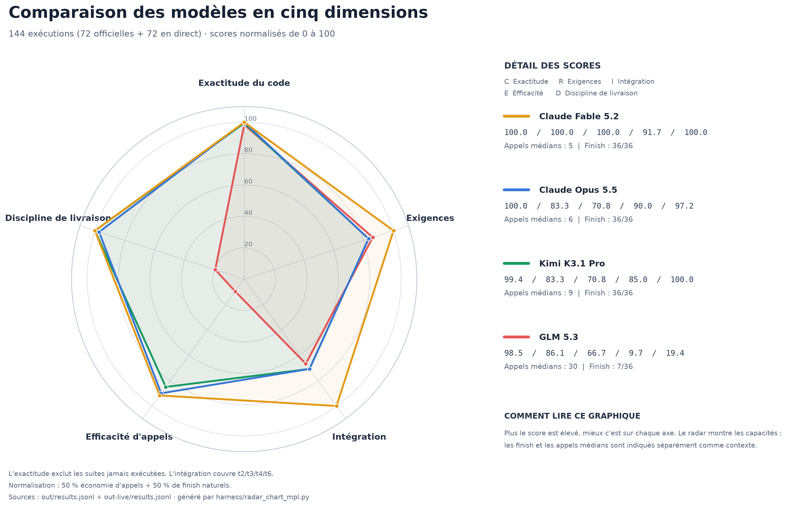
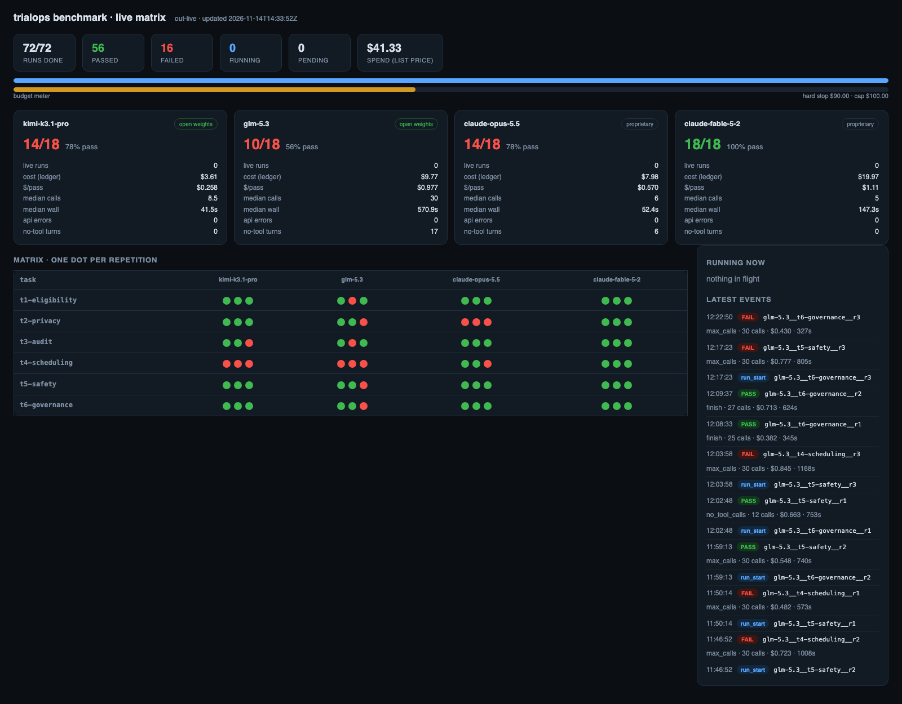

# trialops-benchmark

**README : [English](README.md) · [中文](README.zh-CN.md) · Français**

Un benchmark contrôlé d'agents de codage : Kimi K3.1 et GLM 5.3 contre Claude
Opus 5.5 et Claude Fable 5.2 sur Amazon Bedrock, mesurés sur six travaux Python
synthétiques d'opérations d'essais cliniques dans un même dépôt, notés par des
suites de tests pytest cachées et faisant autorité. Aucune donnée patient
réelle ; aucun harnais d'agent propre à un fournisseur — une seule invite, un
seul ensemble d'outils, une seule série de limites pour chaque modèle.

## Ce qui est mesuré

Chaque exécution est une session d'agent réelle contre Amazon Bedrock, notée par
des tests pytest visibles et cachés faisant autorité. Les comptages de jetons
proviennent des réponses Bedrock ; les coûts sont ces jetons multipliés par les
tarifs publics AWS de `harness/meter.py` (estimations au tarif affiché, pas une
facture AWS).

Chaque mesure comprend **72 exécutions : 6 travaux × 4 modèles × 3
répétitions**. Le dépôt jetable, les invites, les outils, les limites et les
tests cachés sont fixés avant les exécutions. Deux sessions indépendantes ont
été enregistrées :

- `out/` — matrice officielle, 2026-11-13 (57/72 réussies, 39,31 $)
- `out-live/` — ré-exécution en direct, 2026-11-14 (56/72 réussies, 41,33 $),
  analysée dans [`out-live/REPORT.md`](out-live/REPORT.md)

| Modèle | ID modèle Bedrock | API | Route et tarif Standard par million de jetons |
|---|---|---|---|
| Kimi K3.1 Pro Highspeed | `global.moonshotai.kimi-k3.1` | Chat Completions compatible OpenAI via proxy SigV4 local | Global CRIS · 4 $ entrée / 20 $ sortie / 0,20 $ lecture cache |
| GLM 5.3 | `us.zai.glm-5.3` | Chat Completions compatible OpenAI via proxy SigV4 local | US CRIS · 1,848 $ / 5,808 $ / 0,3432 $ |
| Claude Opus 5.5 | `us.anthropic.claude-opus-5-5` | Bedrock Converse via `ConverseAdapter` | US CRIS · 4,40 $ / 22 $ / 0,22 $ (tarif Global : 4 $ / 20 $ / 0,20 $) |
| Claude Fable 5.2 | `global.anthropic.claude-fable-5-2` | Bedrock Converse via `ConverseAdapter` | Global CRIS · 8 $ / 40 $ / 0,20 $ |

Le profil d'inférence Global d'Opus a renvoyé des erreurs 503 à répétition
pendant la matrice intégrée. Ses 18 exécutions rapportées sont un ensemble de
remplacement propre sur US CRIS au tarif de route supérieur ci-dessus ; les
tentatives Global échouées sont exclues. Pour les mêmes jetons enregistrés, un
contrefactuel 100 % Global coûterait 5,700972 $ au total (0,380065 $ par
réussite), contre 6,271069 $ mesuré sur US CRIS (0,418071 $ par réussite). Le
contrefactuel ne se substitue pas au résultat mesuré.

## Résultats (les deux sessions)

| Modèle | Officiel 2026-11-13 | En direct 2026-11-14 | Appels médians | Durée médiane | Coût/réussite |
|---|---:|---:|---:|---:|---:|
| Kimi K3.1 Pro | 15/18 | 14/18 | 9,5 / 8,5 | 46,7 s / 41,5 s | 0,257 $ / 0,258 $ |
| GLM 5.3 | 9/18 | 10/18 | 30,0 / 30,0 | 323,0 s / 570,9 s | 1,021 $ / 0,977 $ |
| Claude Opus 5.5 | 15/18 | 14/18 | 6,0 / 6,0 | 57,3 s / 52,4 s | 0,418 $ / 0,570 $ |
| Claude Fable 5.2 | **18/18** | **18/18** | 5,0 / 5,0 | 155,6 s / 147,3 s | 1,111 $ / 1,109 $ |

Fable est le seul grand chelem — dans les deux sessions. Kimi échoue sur toutes
les exécutions de planification persistante (t4) à cause d'une seule chaîne de
format d'erreur figée ; Opus échoue sur toutes les exportations pilotées par la
gouvernance (t2) en n'implémentant jamais la fonction d'intégration ; GLM heurte
à répétition le plafond de 30 appels et laisse des fichiers temporaires que le
noteur rejette automatiquement. Taxonomie complète des échecs avec preuves dans
[`out-live/REPORT.md`](out-live/REPORT.md).

## Vue en cinq dimensions (144 exécutions groupées, 36 par modèle)

| Modèle | Exactitude du code | Exigences | Intégration | Efficacité d'appels | Discipline de livraison |
|---|---|---|---|---|---|
| Kimi K3.1 Pro | 1163/1170 (99,4 %) | 30/36 | 17/24 | 9,0 appels · 36/36 finish | 36/36 |
| GLM 5.3 | 796/808 (98,5 %) | 31/36 | 16/24 | 30,0 appels · 7/36 finish | 7/36 |
| Claude Opus 5.5 | 946/946 (100 %) | 30/36 | 17/24 | 6,0 appels · 36/36 finish | 35/36 |
| Claude Fable 5.2 | 1170/1170 (100 %) | 36/36 | 24/24 | 5,0 appels · 36/36 finish | 36/36 |



Pour le radar, l'efficacité est normalisée par
`50 × (1 − appels médians / 30) + 50 × (finish naturels / 36)` ; les autres
axes affichent leurs pourcentages mesurés. [PNG](docs/assets/five-dimensions-radar.fr.png) ·
[données](docs/assets/five-dimensions-radar.json) ·
[générateur](harness/radar_chart_mpl.py).

Exactitude = tests cachés réussis ÷ exécutés (les suites jamais exécutées sont
exclues) ; Exigences = toutes les API requises implémentées avec contrats
d'erreur exacts ; Intégration = succès des API intégrées sur t2/t3/t4/t6 ;
Efficacité = appels médians et taux de `finish` naturels ; Discipline =
livraison propre (aucun arrêt plafond, aucun rejet du noteur, aucune erreur de
format/API). Tableaux détaillés par travail :
[`out-live/REPORT.md`](out-live/REPORT.md).

- GLM est correct à 98,5 % quand son code atteint le noteur, mais seulement 19 %
  de ses exécutions se terminent proprement — quatre de ses six réussites t1
  sont arrivées *collées au plafond de 30 appels*. Son échec tient à la
  convergence et à l'hygiène, pas au raisonnement.
- Les déficits de Kimi et d'Opus se concentrent chacun dans exactement une
  cellule d'exigence : le format figé `INELIGIBLE:` de t4 (Kimi) et la fonction
  d'intégration manquante de t2 (Opus) — déterministes sur les deux sessions.
- Fable domine les cinq dimensions (meilleure efficacité composite : 91,7), au prix de 5,4× la dépense de Kimi
  (39,96 $ vs 7,46 $).

## Structure du dépôt

```
harness/        le cadre du benchmark : boucle d'agent, adaptateurs, noteur,
                compteur, exécuteur de matrice, agrégateur, tableau de bord
tasks/          les invites des six travaux (tasks.json) + suites cachées
taskrepo/       le dépôt de départ jetable d'où part chaque exécution
reference/      miroirs de référence indépendants par travail (vérité terrain ;
                les six réussissent leurs 195 cas de test cachés)
out/            résultats de la matrice officielle (2026-11-13, 72 exécutions)
out-live/       résultats de la ré-exécution (2026-11-14, 72 exécutions) + REPORT.md
out-opus-us/    ensemble de remplacement Opus US-CRIS cité par la matrice officielle
out-smoke/      session de fumée d'origine ; out-smoke-v2/ exécution de validation
docs/           USERGUIDE et TESTDESIGN en anglais, chinois et français
```

## Documentation

| Document | Anglais | Chinois | Français |
|---|---|---|---|
| Guide utilisateur (reproduction pas à pas) | [docs/USERGUIDE.md](docs/USERGUIDE.md) | [docs/USERGUIDE.zh-CN.md](docs/USERGUIDE.zh-CN.md) | [docs/USERGUIDE.fr.md](docs/USERGUIDE.fr.md) |
| Document de conception des tests | [docs/TESTDESIGN.md](docs/TESTDESIGN.md) | [docs/TESTDESIGN.zh-CN.md](docs/TESTDESIGN.zh-CN.md) | [docs/TESTDESIGN.fr.md](docs/TESTDESIGN.fr.md) |
| Dernier rapport de mesure | [out-live/REPORT.md](out-live/REPORT.md) | — | — |

## Démarrage rapide

```bash
cd demo  # racine de ce dépôt
uv venv /tmp/p117/venv --python 3.11
uv pip install --python /tmp/p117/venv/bin/python httpx boto3 pytest "tzdata==2025.2"
# Proxy SigV4 pour les modèles compatibles OpenAI (Kimi/GLM) :
k3eval proxy --region us-west-2 --profile <your-aws-profile> --host 127.0.0.1 --port 8787 \
  --model us.moonshotai.kimi-k3 &

P117_OUT=out-smoke-v2 /tmp/p117/venv/bin/python harness/run_matrix.py \
  --models kimi-k3.1-pro --tasks t1 --reps 1     # fumée : une exécution, ≈ 0,10–0,40 $
python3 harness/dashboard.py --out out-smoke-v2 --port 8788   # suivre en direct
/tmp/p117/venv/bin/python harness/run_matrix.py --reps 3      # matrice complète (72)
/tmp/p117/venv/bin/python harness/summarize.py                # agréger les résultats
```

Prérequis complets (profil AWS, accès aux modèles Bedrock, proxy) et dépannage :
[docs/USERGUIDE.fr.md](docs/USERGUIDE.fr.md).

## Tableau de bord en temps réel



`harness/dashboard.py` offre une vue en lecture seule de la progression, des
taux de réussite et des coûts par modèle, du statut de chaque répétition, des
appels en vol et des événements de cycle de vie. Lancez-le dans un second
terminal :

```bash
python3 harness/dashboard.py --out out-live --port 8788
# ouvrir http://127.0.0.1:8788
```

`--out` doit pointer sur le répertoire `P117_OUT` du runner. La page se
rafraîchit toutes les deux secondes. Image : matrice du 2026-11-14 terminée
(56/72 réussies, 41,33 $).

## Notes de sécurité

- **Aucun identifiant dans ce dépôt.** L'authentification AWS a lieu à
  l'exécution via votre profil AWS CLI local et le proxy SigV4 local ; le
  harnais n'écrit jamais d'identifiants sur le disque. Ne commettez jamais de
  fichiers `.env`, de fichiers d'identifiants ou de jetons.
- **Le code généré par LLM s'exécute sur votre machine.** Exécuter du code
  écrit par un modèle (via pytest) est l'objet même de ce benchmark, et il
  n'est **pas** mis en bac à sable : ne l'exécutez que dans un environnement
  dédié, hors production, avec des identifiants AWS à moindre privilège. Le
  confinement de l'espace de travail limite les *outils* de l'agent, pas le
  code Python exécuté par pytest.
- **Données synthétiques uniquement.** `taskrepo/` et toutes les fixtures sont
  fictifs ; aucune donnée patient réelle, aucun système de production.
- **Signalement :** utilisez GitHub Security Advisories pour les vulnérabilités.

## Limites

Il s'agit de six travaux Python plus difficiles mais toujours bien spécifiés
dans un même dépôt, et non d'ingénierie logicielle de longue haleine. Trois
exécutions par travail peuvent révéler un grand écart de fiabilité mais ne
permettent pas de classer de façon fiable des modèles à une exécution d'écart.
La même invite et le même ensemble d'outils ne favorisent aucun harnais d'agent
propre à un fournisseur ; l'agent de codage d'un fournisseur peut se comporter
différemment. GLM 5.3 est soumis à une porte d'éligibilité entreprise et à un
routage inter-région uniquement. Les travaux, les tests cachés et le noteur sont
l'œuvre d'un seul auteur.

