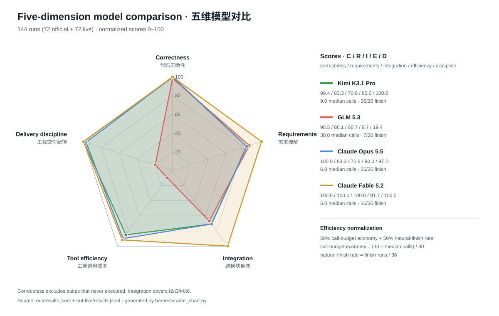

# trialops-benchmark

**README: English · [中文](README.zh-CN.md) · [Français](README.fr.md)**

A controlled coding-agent benchmark: Kimi K3.1 and GLM 5.3 vs Claude Opus 5.5
and Claude Fable 5.2 on Amazon Bedrock, measured on six synthetic
trial-operations Python jobs in one repository, graded by authoritative hidden
pytest suites. No real patient data; no vendor-specific agent harness — one
prompt, one tool set, one set of limits for every model.

## What is measured

Every run is a live agent session against Amazon Bedrock, graded by authoritative
visible and hidden pytest tests. Token counts come from Bedrock responses; costs
are those tokens multiplied by AWS public list prices in `harness/meter.py`
(list-price estimates, not an AWS bill).

Each measurement is **72 runs: 6 jobs × 4 models × 3 repetitions**. The
throwaway repository, prompts, tools, limits, and hidden tests are fixed before
the runs. Two independent sessions have been recorded so far:

- `out/` — official matrix, 2026-11-13 (57/72 passed, $39.31)
- `out-live/` — live re-run, 2026-11-14 (56/72 passed, $41.33), analyzed in
  [`out-live/REPORT.md`](out-live/REPORT.md)

| Model | Bedrock model ID | API | Route and Standard list price per 1M tokens |
|---|---|---|---|
| Kimi K3.1 Pro Highspeed | `global.moonshotai.kimi-k3.1` | OpenAI-compatible Chat Completions through local SigV4 proxy | Global CRIS · $4 input / $20 output / $0.20 cache read |
| GLM 5.3 | `us.zai.glm-5.3` | OpenAI-compatible Chat Completions through local SigV4 proxy | US CRIS · $1.848 input / $5.808 output / $0.3432 cache read |
| Claude Opus 5.5 | `us.anthropic.claude-opus-5-5` | Bedrock Converse through `ConverseAdapter` | US CRIS · $4.40 / $22 / $0.22 (Global list: $4 / $20 / $0.20) |
| Claude Fable 5.2 | `global.anthropic.claude-fable-5-2` | Bedrock Converse through `ConverseAdapter` | Global CRIS · $8 input / $40 output / $0.20 cache read |

The global Opus inference profile repeatedly returned 503 errors during the
integrated matrix. Its reported 18 runs are a clean replacement set on US CRIS
at the higher route price above; failed global attempts are excluded. On the
same recorded tokens, a Global-only counterfactual would cost $5.700972 total
($0.380065 per passed run), versus the official measured US CRIS cost of
$6.271069 ($0.418071 per pass). The counterfactual is not substituted for the
measured result.

## Results (both sessions)

| Model | Official 2026-11-13 | Live 2026-11-14 | Median calls | Median wall | Cost/pass (official) |
|---|---:|---:|---:|---:|---:|
| Kimi K3.1 Pro | 15/18 | 14/18 | 9.5 / 8.5 | 46.7 s / 41.5 s | $0.257 / $0.258 |
| GLM 5.3 | 9/18 | 10/18 | 30.0 / 30.0 | 323.0 s / 570.9 s | $1.021 / $0.977 |
| Claude Opus 5.5 | 15/18 | 14/18 | 6.0 / 6.0 | 57.3 s / 52.4 s | $0.418 / $0.570 |
| Claude Fable 5.2 | **18/18** | **18/18** | 5.0 / 5.0 | 155.6 s / 147.3 s | $1.111 / $1.109 |

Fable is the only clean sweep — in both sessions. Kimi misses every
persistent-scheduling run (t4) on one pinned error-format string; Opus misses
every governance-driven export (t2) by never implementing the integration
function; GLM repeatedly hits the 30-call ceiling and leaves scratch files that
the grader auto-rejects. See [`out-live/REPORT.md`](out-live/REPORT.md) for the
full failure taxonomy with evidence.

## Five-dimension view (144 runs pooled, 36 per model)

| Model | Correctness | Requirements | Integration | Efficiency | Discipline |
|---|---|---|---|---|---|
| Kimi K3.1 Pro | 1163/1170 (99.4%) | 30/36 | 17/24 | 9.0 calls · 36/36 finish | 36/36 |
| GLM 5.3 | 796/808 (98.5%) | 31/36 | 16/24 | 30.0 calls · 7/36 finish | 7/36 |
| Claude Opus 5.5 | 946/946 (100%) | 30/36 | 17/24 | 6.0 calls · 36/36 finish | 35/36 |
| Claude Fable 5.2 | 1170/1170 (100%) | 36/36 | 24/24 | 5.0 calls · 36/36 finish | 36/36 |



For the radar chart, efficiency is normalized as
`50 × (1 − median calls / 30) + 50 × (natural finishes / 36)`; all other axes
show their measured percentages. [SVG](docs/assets/five-dimensions-radar.svg) ·
[data](docs/assets/five-dimensions-radar.json) ·
[generator](harness/radar_chart.py).

Correctness = hidden tests passed ÷ executed (suites that never ran are
excluded); Requirements = every required API implemented with exact error
contracts; Integration = integrated-API success on t2/t3/t4/t6; Efficiency =
median calls and natural `finish` rate; Discipline = clean delivery (no ceiling
stops, no grader rejects, no format/API errors). Full per-job tables:
[`out-live/REPORT.md`](out-live/REPORT.md).

- GLM is 98.5% correct whenever its code reaches the grader, yet only 19% of
  runs finish cleanly — four of its six t1 passes arrived *while pinned at the
  30-call ceiling*. Its failure is convergence and hygiene, not reasoning.
- Kimi's and Opus's deficits each concentrate in exactly one requirement cell:
  t4's pinned `INELIGIBLE:` format (Kimi) and t2's missing integration function
  (Opus) — both deterministic across sessions.
- Fable leads all five dimensions (best composite efficiency: 91.7), at 5.4× Kimi's spend ($39.96 vs $7.46).

## Repository layout

```
harness/        the benchmark framework: agent loop, adapters, grader, meter,
                matrix runner, summarizer, realtime dashboard
tasks/          the six job prompts (tasks.json) + authoritative hidden suites
taskrepo/       the throwaway starter repo every run begins from
reference/      independent reference mirrors per job (ground truth; all six
                pass their 195 hidden test cases)
out/            official matrix results (2026-11-13, 72 runs)
out-live/       live re-run results (2026-11-14, 72 runs) + REPORT.md
out-opus-us/    Opus US-CRIS replacement set referenced by the official matrix
out-smoke/      original smoke session; out-smoke-v2/ validation smoke run
docs/           USERGUIDE + TESTDESIGN in English, Chinese and French
```

## Documentation

| Document | English | Chinese | French |
|---|---|---|---|
| User guide (reproduce step by step) | [docs/USERGUIDE.md](docs/USERGUIDE.md) | [docs/USERGUIDE.zh-CN.md](docs/USERGUIDE.zh-CN.md) | [docs/USERGUIDE.fr.md](docs/USERGUIDE.fr.md) |
| Test design document | [docs/TESTDESIGN.md](docs/TESTDESIGN.md) | [docs/TESTDESIGN.zh-CN.md](docs/TESTDESIGN.zh-CN.md) | [docs/TESTDESIGN.fr.md](docs/TESTDESIGN.fr.md) |
| Latest measurement report | [out-live/REPORT.md](out-live/REPORT.md) | — | — |

## Quick start

```bash
cd demo  # this repository root
uv venv /tmp/p117/venv --python 3.11
uv pip install --python /tmp/p117/venv/bin/python httpx boto3 pytest "tzdata==2025.2"
# SigV4 proxy for the OpenAI-compatible models (Kimi/GLM):
k3eval proxy --region us-west-2 --profile <your-aws-profile> --host 127.0.0.1 --port 8787 \
  --model us.moonshotai.kimi-k3 &

P117_OUT=out-smoke-v2 /tmp/p117/venv/bin/python harness/run_matrix.py \
  --models kimi-k3.1-pro --tasks t1 --reps 1     # smoke: one run, ≈ $0.10–0.40
python3 harness/dashboard.py --out out-smoke-v2 --port 8788   # watch it live
/tmp/p117/venv/bin/python harness/run_matrix.py --reps 3      # full 72-run matrix
/tmp/p117/venv/bin/python harness/summarize.py                # aggregate results
```

Full prerequisites (AWS profile, Bedrock model access, proxy) and
troubleshooting: [docs/USERGUIDE.md](docs/USERGUIDE.md).

## Security notes

- **No credentials in this repository.** AWS authentication happens at runtime
  through your local AWS CLI profile and the local SigV4 proxy; the harness
  never writes credentials to disk. Never commit `.env` files, credential
  files, or tokens.
- **LLM-generated code runs on your machine.** Executing model-written code
  (via pytest) is the point of this benchmark, and it is **not** sandboxed: run
  it only in a dedicated, non-production environment with least-privilege AWS
  credentials. The workspace confinement limits the agent's *tools*, not the
  Python code pytest executes.
- **Synthetic data only.** `taskrepo/` and every fixture are fictional; no real
  patient data, no production systems.
- **Reporting:** please use GitHub Security Advisories for vulnerabilities.

## Limits

These are six harder but still well-specified Python jobs in one repository, not
long-horizon software engineering. Three runs per job can expose a large
reliability gap but cannot reliably rank models one run apart. The same prompt
and tool set favors no vendor-specific agent harness; a vendor's own coding
agent may perform differently. GLM 5.3 has an enterprise eligibility gate and
cross-Region-only routing. The jobs, hidden tests, and grader are single-author
work.

