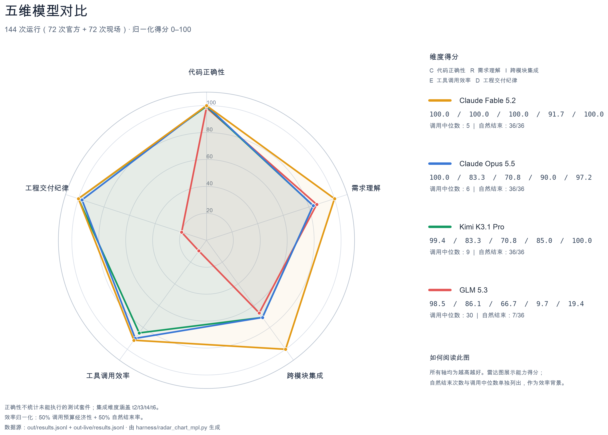
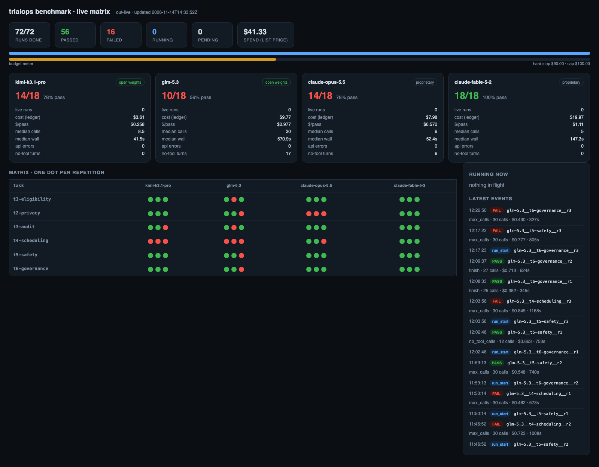

# trialops-benchmark

**README：[English](README.md) · 中文 · [Français](README.fr.md)**

一个受控的编程智能体（coding agent）基准测试：在 Amazon Bedrock 上对比 Kimi K3.1、GLM 5.3 与 Claude Opus 5.5、Claude Fable 5.2，任务为同一仓库中的六个合成的临床试验运营（trial-operations）Python 作业，由权威的隐藏 pytest 测试套件评分。不涉及任何真实患者数据；不使用任何厂商专属智能体框架——所有模型使用同一提示词、同一工具集、同一组硬性限制。

## 测量内容

每次运行都是一次针对 Amazon Bedrock 的真实智能体会话，由权威的可见与隐藏 pytest 测试评分。token 计数来自 Bedrock 响应；成本为这些 token 乘以 `harness/meter.py` 中的 AWS 公开标价（属标价估算，而非 AWS 账单）。

每次测量为 **72 次运行：6 个作业 × 4 个模型 × 3 次重复**。一次性仓库、提示词、工具、限制与隐藏测试在运行前全部固定。目前已记录两次独立测量：

- `out/` —— 官方矩阵，2026-11-13（57/72 通过，$39.31）
- `out-live/` —— 现场复测，2026-11-14（56/72 通过，$41.33），完整分析见
  [`out-live/REPORT.md`](out-live/REPORT.md)

| 模型 | Bedrock 模型 ID | API | 路由与每百万 token 标准标价 |
|---|---|---|---|
| Kimi K3.1 Pro Highspeed | `global.moonshotai.kimi-k3.1` | 经本地 SigV4 代理的 OpenAI 兼容 Chat Completions | Global CRIS · 输入 $4 / 输出 $20 / 缓存读取 $0.20 |
| GLM 5.3 | `us.zai.glm-5.3` | 经本地 SigV4 代理的 OpenAI 兼容 Chat Completions | US CRIS · 输入 $1.848 / 输出 $5.808 / 缓存读取 $0.3432 |
| Claude Opus 5.5 | `us.anthropic.claude-opus-5-5` | 经 `ConverseAdapter` 的 Bedrock Converse | US CRIS · $4.40 / $22 / $0.22（Global 标价：$4 / $20 / $0.20） |
| Claude Fable 5.2 | `global.anthropic.claude-fable-5-2` | 经 `ConverseAdapter` 的 Bedrock Converse | Global CRIS · 输入 $8 / 输出 $40 / 缓存读取 $0.20 |

在矩阵运行期间，Opus 的 Global 推理配置反复返回 503 错误。其报告的 18 次运行是在 US CRIS 上以更高路由价格完成的干净替代集；失败的 Global 尝试已排除。在相同已记录 token 上的纯 Global 反事实成本为 $5.700972（每次通过 $0.380065），而官方实测 US CRIS 成本为 $6.271069（每次通过 $0.418071）。该反事实不替代实测结果。

## 结果（两次测量）

| 模型 | 官方 2026-11-13 | 现场 2026-11-14 | 调用中位数 | 耗时中位数 | 每次通过成本 |
|---|---:|---:|---:|---:|---:|
| Kimi K3.1 Pro | 15/18 | 14/18 | 9.5 / 8.5 | 46.7 s / 41.5 s | $0.257 / $0.258 |
| GLM 5.3 | 9/18 | 10/18 | 30.0 / 30.0 | 323.0 s / 570.9 s | $1.021 / $0.977 |
| Claude Opus 5.5 | 15/18 | 14/18 | 6.0 / 6.0 | 57.3 s / 52.4 s | $0.418 / $0.570 |
| Claude Fable 5.2 | **18/18** | **18/18** | 5.0 / 5.0 | 155.6 s / 147.3 s | $1.111 / $1.109 |

Fable 是唯一全胜的模型——两次测量皆然。Kimi 在一个固定错误格式字符串上错失全部持久化调度运行（t4）；Opus 因从未实现集成函数而错失全部治理驱动的导出（t2）；GLM 反复触及 30 次调用上限，并留下被评分器自动判负的临时文件。完整的失败分类与证据见 [`out-live/REPORT.md`](out-live/REPORT.md)。

## 五维视图（合并 144 次运行，每模型 36 次）

| 模型 | 代码正确性 | 需求理解 | 跨模块集成 | 工具调用效率 | 工程交付纪律 |
|---|---|---|---|---|---|
| Kimi K3.1 Pro | 1163/1170 (99.4%) | 30/36 | 17/24 | 9.0 次调用 · 36/36 自然结束 | 36/36 |
| GLM 5.3 | 796/808 (98.5%) | 31/36 | 16/24 | 30.0 次调用 · 7/36 自然结束 | 7/36 |
| Claude Opus 5.5 | 946/946 (100%) | 30/36 | 17/24 | 6.0 次调用 · 36/36 自然结束 | 35/36 |
| Claude Fable 5.2 | 1170/1170 (100%) | 36/36 | 24/24 | 5.0 次调用 · 36/36 自然结束 | 36/36 |



雷达图中，工具调用效率归一化为
`50 × (1 − 调用中位数 / 30) + 50 × (自然 finish 次数 / 36)`；其余各轴均为
实测百分比。[PNG 图](docs/assets/five-dimensions-radar.zh-CN.png) ·
[数据](docs/assets/five-dimensions-radar.json) ·
[生成脚本](harness/radar_chart_mpl.py)。

代码正确性 = 隐藏测试通过数 ÷ 实际执行的隐藏测试数（套件未能运行的不计）；
需求理解 = 实现了全部必需 API 且遵守精确错误契约；跨模块集成 = t2/t3/t4/t6
集成 API 的成功率；工具调用效率 = 调用中位数与自然 `finish` 比例；工程交付
纪律 = 干净交付（无触顶停止、无评分器判负、无格式/API 错误）。逐作业明细表：
[`out-live/REPORT.md`](out-live/REPORT.md)。

- GLM 在代码到达评分器时正确率高达 98.5%，但只有 19% 的运行干净收尾——其
  t1 的 6 次通过中有 4 次是*顶着 30 次调用上限*完成的。它的失败在于收敛与
  整洁，而非推理能力。
- Kimi 与 Opus 的失分各集中在一个需求单元：Kimi 是 t4 钉死的 `INELIGIBLE:`
  格式，Opus 是 t2 缺失的集成函数——两者在两次会话中均为确定性复现。
- Fable 五个维度全面领先（复合效率得分最高：91.7），代价是花费为 Kimi 的 5.4 倍（$39.96 vs $7.46）。

## 仓库结构

```
harness/        基准框架：智能体循环、适配器、评分器、计量器、
                矩阵运行器、汇总器、实时仪表板
tasks/          六个作业的提示词（tasks.json）+ 权威隐藏测试套件
taskrepo/       每次运行起始的一次性初始仓库
reference/      每个作业独立的参考镜像（基准真值；六个镜像全部通过
                195 个隐藏测试用例）
out/            官方矩阵结果（2026-11-13，72 次运行）
out-live/       现场复测结果（2026-11-14，72 次运行）+ REPORT.md
out-opus-us/    官方矩阵引用的 Opus US-CRIS 替代运行集
out-smoke/      原始冒烟会话；out-smoke-v2/ 验证性冒烟运行
docs/           USERGUIDE 与 TESTDESIGN 的 English、中文、Français 版本
```

## 文档

| 文档 | English | 中文 | Français |
|---|---|---|---|
| 用户指南（逐步复现） | [docs/USERGUIDE.md](docs/USERGUIDE.md) | [docs/USERGUIDE.zh-CN.md](docs/USERGUIDE.zh-CN.md) | [docs/USERGUIDE.fr.md](docs/USERGUIDE.fr.md) |
| 测试设计文档 | [docs/TESTDESIGN.md](docs/TESTDESIGN.md) | [docs/TESTDESIGN.zh-CN.md](docs/TESTDESIGN.zh-CN.md) | [docs/TESTDESIGN.fr.md](docs/TESTDESIGN.fr.md) |
| 最新测量报告 | [out-live/REPORT.md](out-live/REPORT.md) | — | — |

## 快速开始

```bash
cd demo  # 本仓库根目录
uv venv /tmp/p117/venv --python 3.11
uv pip install --python /tmp/p117/venv/bin/python httpx boto3 pytest "tzdata==2025.2"
# OpenAI 兼容模型（Kimi/GLM）所需的 SigV4 代理：
k3eval proxy --region us-west-2 --profile <your-aws-profile> --host 127.0.0.1 --port 8787 \
  --model us.moonshotai.kimi-k3 &

P117_OUT=out-smoke-v2 /tmp/p117/venv/bin/python harness/run_matrix.py \
  --models kimi-k3.1-pro --tasks t1 --reps 1     # 冒烟：单次运行，约 $0.10–0.40
python3 harness/dashboard.py --out out-smoke-v2 --port 8788   # 实时观察
/tmp/p117/venv/bin/python harness/run_matrix.py --reps 3      # 完整 72 次运行矩阵
/tmp/p117/venv/bin/python harness/summarize.py                # 汇总结果
```

完整前置条件（AWS 配置、Bedrock 模型访问权限、代理）与故障排查：
[docs/USERGUIDE.zh-CN.md](docs/USERGUIDE.zh-CN.md)。

## 实时仪表板



`harness/dashboard.py` 以只读方式实时展示运行进度、各模型通过率与成本、
每次重复的状态、在途调用和生命周期事件。在第二个终端中启动：

```bash
python3 harness/dashboard.py --out out-live --port 8788
# 打开 http://127.0.0.1:8788
```

`--out` 必须指向运行器的 `P117_OUT` 目录，页面每两秒刷新一次。图中为已完成的
2026-11-14 矩阵（56/72 通过，$41.33）。

## 安全说明

- **本仓库不含任何凭证。** AWS 认证在运行时通过你本地的 AWS CLI 配置与本地
  SigV4 代理完成；框架不会把凭证写入磁盘。切勿提交 `.env`、凭证文件或令牌。
- **LLM 生成的代码会在你的机器上执行。** 运行模型编写的代码（经 pytest）正是
  本基准的目的，且**不做沙箱隔离**：请仅在专用、非生产环境中、使用最小权限
  AWS 凭证运行。工作区隔离限制的是智能体的*工具*，而非 pytest 所执行的
  Python 代码。
- **仅含合成数据。** `taskrepo/` 与所有测试数据均为虚构；无真实患者数据、
  无生产系统。
- **漏洞报告：** 请使用 GitHub Security Advisories。

## 局限

这是同一仓库中六个更难但仍被明确规约的 Python 作业，而非长周期软件工程。每个作业 3 次重复足以暴露较大的可靠性差距，但无法可靠地区分相差一次运行的模型。统一的提示词与工具集不偏向任何厂商专属智能体框架；厂商自有的编程智能体表现可能不同。GLM 5.3 有企业资格门槛且仅支持跨区域路由。作业、隐藏测试与评分器均为单人编写。
