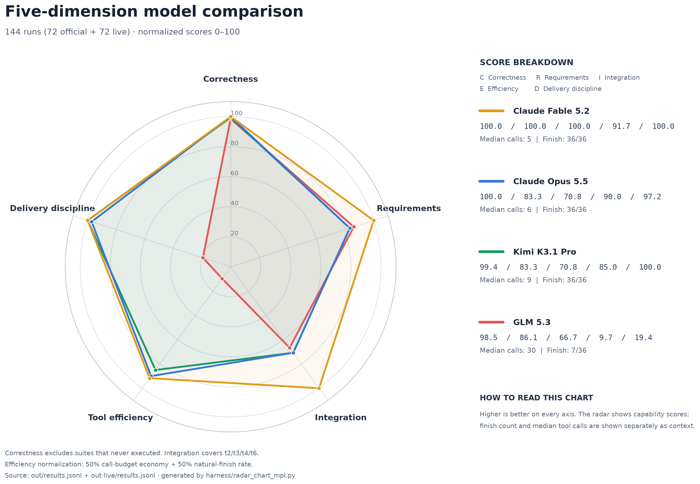

# Detailed Test Report — Live Re-Run of the 72-Run Bedrock Agent Matrix

**Dataset:** `demo/out-live/` (append-only `results.jsonl`, `spend.jsonl`, `events.jsonl`, per-run `runs/<run_id>/{transcript.json,diff.patch}`)
**Window:** 2026-11-14 10:15:19Z → 11:22:50Z (≈ 68 min wall, 12 parallel lanes)
**Configuration:** identical to the official 2026-11-13 measurement — 6 tasks × 4 models × 3 repetitions = 72 runs; same prompt, tools (list/read/write/edit/run_tests/finish), limits (30 calls, 20 min, 16,384 completion tokens), hidden test suites (195 cases), pristine-checkout grading.
**Total measured cost:** **$41.33** list price (meter hard stop $90 / cap $100 never approached).

## 1. Headline results

| Model | Passed | Solved 3/3 | Median calls | Median wall | Total cost | Cost/pass | Stop reasons |
|---|---:|---:|---:|---:|---:|---:|---|
| Kimi K3.1 Pro | 14/18 | 4/6 | 8.5 | 41.5 s | $3.61 | **$0.258** | finish ×18 |
| GLM 5.3 | 10/18 | 0/6 | 30.0 | 570.9 s | $9.77 | $0.977 | max_calls ×13, wall_clock ×1, no_tool ×1, finish ×3 |
| Claude Opus 5.5 | 14/18 | 4/6 | 6.0 | 52.4 s | $7.98 | $0.570 | finish ×18 |
| Claude Fable 5.2 | **18/18** | **6/6** | 5.0 | 147.3 s | $19.97 | $1.109 | finish ×18 |

- **Fable is again the only clean sweep** — second session in a row, 18/18.
- **Kimi and Opus tie at 14/18** (official run: 15/18 each). Kimi remains the cost-efficiency leader by a wide margin.
- **GLM improved 9→10 passes** but is the only model with non-`finish` stops: 13 of 18 runs hit the 30-call ceiling, one hit the 20-minute wall clock (1,270 s), one stalled on idle turns. Median GLM run takes **9.5 minutes** — 11–14× slower than the others.
- Zero malformed tool calls and zero API errors across all 72 runs (GLM's 6 server errors in the official run did not recur).

## 2. Per-task results (passed / 3 runs)

| Task | Kimi | GLM | Opus | Fable |
|---|---|---|---|---|
| t1-eligibility | 3/3 | 2/3 | 3/3 | 3/3 |
| t2-privacy | 3/3 | 2/3 | **0/3** | 3/3 |
| t3-audit | 2/3 | 2/3 | 3/3 | 3/3 |
| t4-scheduling | **0/3** | **0/3** | 2/3 | 3/3 |
| t5-safety | 3/3 | 2/3 | 3/3 | 3/3 |
| t6-governance | 3/3 | 2/3 | 3/3 | 3/3 |

Two tasks remain the discriminators: **t2-privacy** (Opus fails all three, deterministically, as in the official run) and **t4-scheduling** (Kimi and GLM fail all three).

## 3. Failure analysis (16 failed runs, all inspected)

Grading tails were extracted from every failed run and classified. Four distinct
failure classes account for all 16:

| Class | Runs | Models | Nature |
|---|---:|---|---|
| A. Missing integration function (`execute_reuse_export`) | 4 | Opus ×3, GLM ×1 | Instruction coverage — second half of the prompt never implemented; hidden suite cannot even be imported |
| B. Grader auto-reject: unauthorized file left in repo | 7 | GLM ×6, Opus ×1 | Process hygiene — scratch/probe artifacts outside `trialops/*.py` or `tests/test_*.py` |
| C. `INELIGIBLE:` separator format | 3 | Kimi ×3 | Exact-string mismatch: model wrote `INELIGIBLE: A, B`, test pins `INELIGIBLE:A,B` |
| D. Genuine assertion failures | 2 (+1 near-miss) | GLM ×2, Kimi ×1 | Real logic bugs (see evidence) |

### Class A — missing `execute_reuse_export` (4 runs)

The t2 prompt has two parts: `export_subjects` **plus** the governance-integrated
`execute_reuse_export`. The hidden suite imports both at module load, so the miss
fails collection — 0 tests execute (0p/0f/1e, suite and hidden alike).

| Run | Stop | Calls | Wall | Cost |
|---|---|---:|---:|---|
| `claude-opus-5.5__t2-privacy__r1` | finish | 7 | 81 s | $0.505 |
| `claude-opus-5.5__t2-privacy__r2` | finish | 9 | 94 s | $0.659 |
| `claude-opus-5.5__t2-privacy__r3` | finish | 9 | 108 s | $0.702 |
| `glm-5.3__t2-privacy__r3` | wall_clock | 12 | 1,270 s | $0.562 |

Grading tail (all four): `ImportError: cannot import name 'execute_reuse_export'
from 'trialops.privacy'`.

Opus's three runs are the notable ones: it implemented `export_subjects` cleanly,
called `finish` after 7–9 calls believing the task complete, and never discovered
part two — **the identical failure it produced in the official run** (0/3 there
too). This is a stable, deterministic instruction-coverage gap, not variance.
GLM r3 instead burned the full 20-minute wall clock without converging.

### Class B — unauthorized file changes (7 runs)

The grader rejects any change outside `trialops/*.py` and `tests/test_*.py`
before a single test executes. Every one of these runs was auto-failed
regardless of code quality:

| Run | Offending artifact | Stop |
|---|---|---|
| `claude-opus-5.5__t4-scheduling__r3` | `tests/test_booking_extra.tmp` | finish (13 calls) |
| `glm-5.3__t1-eligibility__r2` | `scratch_probe.py` (repo root) | max_calls |
| `glm-5.3__t3-audit__r2` | `probe_audit.py` (repo root) | max_calls |
| `glm-5.3__t4-scheduling__r2` | `tests/_scratch_check.py` | max_calls |
| `glm-5.3__t5-safety__r3` | `scratch_check.py` (repo root) | max_calls |
| `glm-5.3__t6-governance__r3` | `tests/_scratch_check.py` | max_calls |

GLM habitually writes throwaway probe scripts and leaves them behind (root-level
files, or `tests/_*.py` which fails the `test_*` naming rule). The Opus r3 case
is new behavior versus the official run: it authored an extra ad-hoc test file
with a `.tmp` suffix and declared `finish` without cleaning it up — its only
process-hygiene slip observed in either session. Note five of these seven runs
*also* hit `max_calls`, so most would likely have failed on test outcome anyway;

### Class C — `INELIGIBLE:` separator format (3 runs)

All three Kimi t4-scheduling runs, 25/26 hidden tests passed, one test failed:

```
FAILED tests/test_hidden_scheduling.py::test_ineligibility_is_ordered_and_does_not_start_planning
E       assert 'INELIGIBLE: ...W, LAB_z_HIGH' == 'INELIGIBLE:C...OW,LAB_z_HIGH'
E         - INELIGIBLE:CONSENT_MISSING,CONSENT_VERSION,AGE_BELOW_MIN,EXCLUSION_Z_FLAG,EXCLUSION_A_FLAG,LAB_A_LOW,LAB_z_HIGH
E         + INELIGIBLE: CONSENT_MISSING, CONSENT_VERSION, AGE_BELOW_MIN, EXCLUSION_Z_FLAG, EXCLUSION_A_FLAG, LAB_A_LOW, LAB_z_HIGH
```

The hidden test pins `"INELIGIBLE:" + ",".join(reasons)` (no spaces, matching the
reference implementation); Kimi emits a space after the colon and after each
comma. The prompt text ("raise ValueError with `INELIGIBLE:` plus the ordered
reasons") does not explicitly pin the separator, so this is an
exact-specification trap rather than a reasoning error — but it is **fully
deterministic**: Kimi failed the identical assertion in all 3 runs of both
sessions (6/6 overall). Runs: `kimi-k3.1-pro__t4-scheduling__r1/r2/r3`
(10/21/29 calls, $0.244/$0.418/$0.360).

### Class D — genuine assertion failures (3 runs)

1. **`glm-5.3__t4-scheduling__r1`** (25/26 hidden) —
   `test_booking_requires_an_actual_dict_for_capacity[capacity1]`:
   `Failed: DID NOT RAISE TypeError`. The spec requires `capacity` to be a real
   caller-owned mutable dict; GLM's implementation accepted an immutable
   `mappingproxy` instead of rejecting it.
2. **`glm-5.3__t4-scheduling__r3`** (24/26 hidden) — the same type-check miss,
   plus `test_multiple_visits_compete_and_each_consumes_a_listed_slot`:
   `assert {date(2024,4,1): 1} == {date(2024,4,1): 0}` — a slot-decrement
   accounting bug: the visit was planned but the capacity entry was not
   decremented after success.
3. **`kimi-k3.1-pro__t3-audit__r3`** (56/57 hidden) —
   `test_from_records_materialization_failure_is_an_invalid_chain`:
   `TypeError: 'NoneType' object is not iterable` at `trialops/audit.py:95`.
   Kimi's restore path iterates an unvalidated field when the snapshot contains
   a malformed record, crashing instead of raising `ValueError` with the
   `INVALID_CHAIN:<codes>` contract. One edge case short of a pass; the other
   two Kimi t3 runs passed 57/57.

## 4. Reliability and process metrics

| Model | Total calls | Stop distribution | No-tool turns | Format failures | API errors |
|---|---:|---|---:|---:|---:|
| Kimi | 183 | finish ×18 | 0 | 0 | 0 |
| GLM | 486 | max_calls ×13, wall_clock ×1, no_tool ×1, finish ×3 | 17 | 0 | 0 |
| Opus | 130 | finish ×18 | 6 | 0 | 0 |
| Fable | 94 | finish ×18 | 0 | 0 | 0 |

GLM consumed **3.7× more model calls than Opus and 5.2× more than Fable** for
half the pass rate; 89% of its output tokens are reasoning. Its 17 idle no-tool
turns and 13 ceiling hits indicate repeated generate-without-act loops. Every
Kimi/Opus/Fable run ended with an explicit `finish` — their failures are
content failures, not process failures (Opus's one `.tmp` file excepted).

## 5. Token usage and cost

| Model | Input tokens | Output tokens | Reasoning share of output | Cache-read share of input | Total cost |
|---|---:|---:|---:|---:|---:|
| Kimi | 1,561,699 | 132,672 | 69.9% | 89.1% | $3.61 |
| GLM | 6,857,332 | 1,170,239 | 88.9% | 94.0% | $9.77 |
| Opus | 1,190,715 | 124,603 | 0%* | 0%* | $7.98 |
| Fable | 1,020,764 | 295,039 | 0%* | 0%* | $19.97 |

\* The Converse adapter reports no reasoning breakdown and sets no cache points,
so Claude token costs are upper bounds; Kimi/GLM benefit from heavy prompt
caching at $0.20–0.34/1M. Costs are measured tokens × AWS list price
(`harness/meter.py`), not an AWS bill.

## 6. Five-dimension breakdown (144 runs: official + live pooled)

Both sessions used identical configuration, so they are pooled: **6 runs per
(model, job) cell, 36 runs per model**. Dimensions:

- **Correctness** — hidden tests passed ÷ hidden tests executed.
  Runs whose suite never ran (import error at collection, or grader reject) are
  *not assessable* and excluded, noted as `exec n/6`.
- **Requirements** — share of runs implementing **every** required API
  and honoring exact error contracts: no missing-function import errors
  (`execute_reuse_export`, `book_subject_visits`), no pinned-format mismatches
  (`INELIGIBLE:` / `INVALID_CHAIN:` separators).
- **Integration** — for jobs with an integration extension
  (t2/t3/t4/t6): share of runs whose integrated API exists and works, with
  failures attributed to the integration part from the grading tails
  (t2: missing `execute_reuse_export`; t3: `from_records`/`INVALID_CHAIN:`
  errors; t4: booking/capacity/`INELIGIBLE:` errors; t6: executor seam).
  t1/t5 have no integration extension (—).
- **Tool efficiency** — median model calls per run; the model
  rollup adds the share of runs ending naturally (`finish`) vs ceilings.
- **Delivery discipline** — share of runs with clean delivery:
  `finish` stop, no unauthorized-file grader reject, zero format failures,
  zero API errors.

### 6.1 Model rollup (36 runs each)

| Model | Correctness | Requirements | Integration | Efficiency (med calls · finish) | Discipline |
|---|---|---|---|---|---|
| Kimi K3.1 Pro | 1163/1170 (99.4%) | 30/36 | 17/24 | 9.0 · 36/36 | 36/36 |
| GLM 5.3 | 796/808 (98.5%) | 31/36 | 16/24 | 30.0 · 7/36 | 7/36 |
| Claude Opus 5.5 | 946/946 (100%) | 30/36 | 17/24 | 6.0 · 36/36 | 35/36 |
| Claude Fable 5.2 | 1170/1170 (100%) | 36/36 | 24/24 | 5.0 · 36/36 | 36/36 |



For the radar chart, the efficiency axis is normalized to a 0–100 composite:
`50 × (1 − median calls / 30) + 50 × (natural finishes / 36)`. All other axes
show their measured percentages. Normalized scores (C/R/I/E/D): Kimi
99.4/83.3/70.8/85.0/100.0; GLM 98.5/86.1/66.7/9.7/19.4; Opus
100.0/83.3/70.8/90.0/97.2; Fable 100.0/100.0/100.0/91.7/100.0.
[PNG image](../docs/assets/five-dimensions-radar.png) ·
[machine-readable data](../docs/assets/five-dimensions-radar.json) ·
[generator](../harness/radar_chart_mpl.py).

### 6.2 Per-job detail

**Kimi K3.1 Pro**

| Job | Pass | Correctness | Requirements | Integration | Med calls | Discipline |
|---|---|---|---|---|---|---|
| t1-eligibility | 6/6 | 114/114 (100%) | 6/6 | — | 5.0 | 6/6 |
| t2-privacy | 6/6 | 198/198 (100%) | 6/6 | 6/6 | 13.5 | 6/6 |
| t3-audit | 5/6 | 341/342 (99.7%) | 6/6 | 5/6 | 9.0 | 6/6 |
| t4-scheduling | 0/6 | 150/156 (96%) | 0/6 | 0/6 | 16.5 | 6/6 |
| t5-safety | 6/6 | 90/90 (100%) | 6/6 | — | 8.5 | 6/6 |
| t6-governance | 6/6 | 270/270 (100%) | 6/6 | 6/6 | 6.0 | 6/6 |

**GLM 5.3**

| Job | Pass | Correctness | Requirements | Integration | Med calls | Discipline |
|---|---|---|---|---|---|---|
| t1-eligibility | 4/6 | 76/76 (100%, exec 4/6) | 6/6 | — | 30.0 | 0/6 |
| t2-privacy | 3/6 | 99/99 (100%, exec 3/6) | 4/6 | 4/6 | 30.0 | 0/6 |
| t3-audit | 4/6 | 277/285 (97%, exec 5/6) | 5/6 | 5/6 | 30.0 | 2/6 |
| t4-scheduling | 0/6 | 74/78 (95%, exec 3/6) | 4/6 | 1/6 | 30.0 | 0/6 |
| t5-safety | 3/6 | 45/45 (100%, exec 3/6) | 6/6 | — | 30.0 | 1/6 |
| t6-governance | 5/6 | 225/225 (100%, exec 5/6) | 6/6 | 6/6 | 26.0 | 4/6 |

**Claude Opus 5.5**

| Job | Pass | Correctness | Requirements | Integration | Med calls | Discipline |
|---|---|---|---|---|---|---|
| t1-eligibility | 6/6 | 114/114 (100%) | 6/6 | — | 6.0 | 6/6 |
| t2-privacy | 0/6 | n/a (exec 0/6) | 0/6 | 0/6 | 7.5 | 6/6 |
| t3-audit | 6/6 | 342/342 (100%) | 6/6 | 6/6 | 6.0 | 6/6 |
| t4-scheduling | 5/6 | 130/130 (100%, exec 5/6) | 6/6 | 5/6 | 8.0 | 5/6 |
| t5-safety | 6/6 | 90/90 (100%) | 6/6 | — | 6.0 | 6/6 |
| t6-governance | 6/6 | 270/270 (100%) | 6/6 | 6/6 | 5.5 | 6/6 |

**Claude Fable 5.2**

| Job | Pass | Correctness | Requirements | Integration | Med calls | Discipline |
|---|---|---|---|---|---|---|
| t1-eligibility | 6/6 | 114/114 (100%) | 6/6 | — | 5.0 | 6/6 |
| t2-privacy | 6/6 | 198/198 (100%) | 6/6 | 6/6 | 6.0 | 6/6 |
| t3-audit | 6/6 | 342/342 (100%) | 6/6 | 6/6 | 4.5 | 6/6 |
| t4-scheduling | 6/6 | 156/156 (100%) | 6/6 | 6/6 | 4.5 | 6/6 |
| t5-safety | 6/6 | 90/90 (100%) | 6/6 | — | 5.5 | 6/6 |
| t6-governance | 6/6 | 270/270 (100%) | 6/6 | 6/6 | 5.0 | 6/6 |

### 6.3 What the dimensions reveal

- **Correctness and delivery are independent axes.** GLM is 98.5% correct
  whenever its code reaches the grader, yet delivers cleanly in only 19% of
  runs — and **four of its six t1 passes arrived while pinned at the 30-call
  ceiling** (the grader scores repo state regardless of stop reason). GLM's
  failure is not reasoning; it is convergence and hygiene.
- **Kimi's deficit is exactly one requirement cell.** 96% correctness on t4 and
  flawless discipline elsewhere: the 0/6 on t4 is contract-literalness (the
  pinned `INELIGIBLE:` format), not logic. Everything else is ≥ 99.7%.
- **Opus's deficit is exactly one requirements/integration cell.** 100%
  correctness on every suite it reached — but t2's suite was never reached
  (0/6 import errors), so its correctness there is *not assessable*. Its 5/6 on
  t4 discipline is the one-off `.tmp` file.
- **Fable leads all five dimensions** — 100 on correctness, requirements,
  integration and discipline, plus the best composite efficiency score (91.7).
  The premium is real: $39.96 vs Kimi's $7.46 across 36 runs (5.4×).
- **Efficiency anti-correlates with stall behavior, not with quality.** Fable
  5.0 < Opus 6.0 < Kimi 9.0 ≪ GLM 30.0 calls. Kimi's extra calls are productive
  verify-edit loops (it re-runs tests), GLM's are stalls: the ceiling hit 13
  times per 18 runs.

## 7. Comparison with the official 2026-11-13 matrix

| Model | Official pass | Live pass | Official $/pass | Live $/pass | Verdict |
|---|---:|---:|---:|---:|---|
| Kimi | 15/18 | 14/18 | $0.257 | $0.258 | within noise (t3 r3 edge bug cost one run) |
| GLM | 9/18 | 10/18 | $1.021 | $0.977 | within noise; same process-driven profile |
| Opus | 15/18 | 14/18 | $0.418 | $0.570 | t2 gap stable; new one-off `.tmp` hygiene slip |
| Fable | 18/18 | 18/18 | $1.111 | $1.109 | **perfectly stable sweep** |
| Total | 57/72 | 56/72 | — | — | $39.31 → $41.33 |

Stable across both sessions: Fable's sweep; Opus's deterministic t2
instruction-coverage gap (0/6 combined); Kimi's deterministic t4 separator
failure (0/6 combined); GLM's ceiling-hitting, scratch-file-leaving process
profile. New in this session: Opus's `test_booking_extra.tmp` auto-reject and
Kimi's t3 `NoneType` restore bug. Nothing in either session changes the
ranking: **Fable > Kimi ≈ Opus > GLM**, with Kimi the clear cost/performance
leader ($0.258 per pass — 2.2× cheaper than Opus, 4.3× cheaper than Fable).

## 8. Methodology and evidence

- Harness: `demo/harness/` (`run_matrix.py`, `agent.py`, `meter.py`); 12
  parallel lanes; append-only `results.jsonl` / `spend.jsonl` / `events.jsonl`.
- Grading: agent's `trialops/*.py` changes applied to a pristine checkout;
  authoritative visible + hidden suites; agent-authored tests/config ignored;
  any change outside `trialops/*.py` or `tests/test_*.py` auto-fails; skips and
  xfail/xpass count as failure.
- Per-run evidence: `runs/<run_id>/transcript.json` (verbatim calls) and
  `runs/<run_id>/diff.patch` (final source diff). Failure tails quoted above
  come from the `grade.hidden.tail` fields of `results.jsonl`.
- Dashboard: live run was tracked at `harness/dashboard.py` (port 8788);
  the same state is reproducible offline from the JSONL files.

